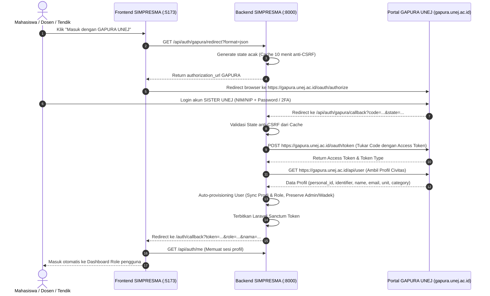

# SIMPRESMA Backend (API)

**Sistem Informasi Manajemen Prestasi Mahasiswa** — RESTful API Backend berbasis Laravel 11 untuk pengelolaan, verifikasi bertingkat, dan konversi reward prestasi perlombaan mahasiswa ke Satuan Kredit Semester (SKS) di lingkungan Fakultas Ilmu Komputer Universitas Jember, terintegrasi penuh dengan **GAPURA UNEJ (Single Sign-On / OAuth 2.0 & OpenID Connect)** dan **Telegram Bot Notification**.

---

## Daftar Isi
- [Gambaran Umum](#gambaran-umum)
- [Tech Stack](#tech-stack)
- [Arsitektur & Sistem Multi-Role](#arsitektur--sistem-multi-role)
- [Integrasi GAPURA UNEJ (SSO / OIDC)](#integrasi-gapura-unej-sso--oidc)
- [Alur Bisnis & Konversi SKS](#alur-bisnis--konversi-sks)
- [Integrasi Telegram Bot](#integrasi-telegram-bot)
- [Katalog Endpoint API](#katalog-endpoint-api)
- [Keamanan & Global Error Handler](#keamanan--global-error-handler)
- [Konfigurasi Environment (.env)](#konfigurasi-environment-env)
- [Panduan Instalasi & Menjalankan](#panduan-instalasi--menjalankan)
- [Akun Pengujian (Seeder)](#akun-pengujian-seeder)
- [Pengujian Otomatis (Automated Tests)](#pengujian-otomatis-automated-tests)

---

## Gambaran Umum

SIMPRESMA Backend melayani seluruh kebutuhan proses bisnis konversi prestasi mahasiswa FASILKOM UNEJ. Sistem ini mengubah sertifikat dan bukti partisipasi lomba menjadi konversi nilai mata kuliah yang diakui secara akademis melalui verifikasi berjenjang dari dosen verifikator program studi hingga bagian akademik (Tendik).

Selain login manual lokal, sistem telah terintegrasi dengan portal terpusat **GAPURA UNEJ** (`https://gapura.unej.ac.id`), memungkinkan mahasiswa, dosen, dan staf tendik masuk menggunakan akun tunggal SISTER Universitas Jember dengan verifikasi dua langkah (2FA) dan passkey.

---

## Tech Stack

| Komponen | Teknologi | Keterangan |
|---|---|---|
| **Framework** | Laravel 11.x | Arsitektur modern dengan konfigurasi `bootstrap/app.php` |
| **Bahasa Pemrograman** | PHP ≥ 8.2 | Type hinting ketat, null-safety, dan ekosistem PHP modern |
| **Autentikasi Lokal** | Laravel Sanctum | Token-based Authentication (Bearer Token) stateful/stateless |
| **Autentikasi Kampus** | GAPURA UNEJ (OIDC / OAuth 2.0) | Authorization Code Flow dengan proteksi anti-CSRF state token |
| **Database** | MySQL ≥ 8.0 / MariaDB | Relasional dengan foreign keys, indexing, dan migrasi terstruktur |
| **Export Engine** | PhpSpreadsheet | Ekspor data laporan pengajuan berformat Excel (`.xlsx`) |
| **Notifikasi Real-time** | Telegram Bot API | Notifikasi instan *event-driven* untuk setiap perubahan status |
| **Testing Suite** | PHPUnit | 82 unit & feature tests, 556 assertions (100% Pass) |

---

## Arsitektur & Sistem Multi-Role

SIMPRESMA menerapkan sistem otorisasi **Multi-Role Dinamis**, di mana satu akun pengguna dapat memiliki lebih dari satu role secara bersamaan dengan audit trail lengkap.

### 5 Role Pengguna:
1. **Mahasiswa (`mahasiswa`):**
   - Mengajukan klaim prestasi baru beserta dokumen bukti lomba.
   - Memilih mata kuliah yang relevan dengan bidang lomba.
   - Memantau linimasa status verifikasi, feedback catatan, dan Surat Keputusan (SK).
2. **Dosen Verifikator (`verifikator`):**
   - Melakukan validasi pengajuan yang masuk sesuai lingkup program studi yang ditugaskan (Sistem Informasi, Teknologi Informasi, Informatika).
   - Menyetujui (ACC) atau menolak pengajuan dengan mencantumkan feedback/alasan penolakan.
3. **Bagian Akademik / Tendik (`tendik`):**
   - Memvalidasi pengajuan berstatus disetujui untuk penerbitan SK Konversi.
   - Menginput huruf nilai SKS (strict sesuai matriks reward).
   - Mengunggah tautan Surat Keputusan (SK) konversi resmi dan memberikan catatan akademik.
   - Mengekspor data pengajuan ke file Excel.
4. **Wakil Dekan I (`wadek`):**
   - Mengelola tabel Matriks Konversi Prestasi (rentang SKS & huruf nilai).
   - Menugaskan atau mencabut dosen verifikator untuk setiap program studi.
   - Mengelola pemetaan (*mapping*) Bidang Lomba terhadap Mata Kuliah kurikulum.
   - Memantau dashboard analitik dan statistik prestasi fakultas.
5. **Administrator (`admin`):**
   - Mengelola hak akses dan role pengguna (Multi-Role Management).
   - Menetapkan role baru (`assignRole`) atau mencabut role (`revokeRole`).
   - Memantau audit trail riwayat perubahan role pengguna (`role_history`).

---

## Integrasi GAPURA UNEJ (SSO / OIDC)

Sistem telah mengimplementasikan integrasi resmi dengan portal **GAPURA UNEJ** (`https://gapura.unej.ac.id`) menggunakan standar **OAuth 2.0 & OpenID Connect**.

### Arsitektur Alur Autentikasi GAPURA:


### Keunggulan Desain GAPURA SIMPRESMA:
* **Anti-CSRF State Protection:** Setiap *handshake* otorisasi dilindungi token state acak 40-karakter unik dengan masa kadaluarsa 10 menit.
* **Smart Auto-Provisioning:** Pengguna yang belum pernah terdaftar di SIMPRESMA akan dibuatkan akun otomatis berdasarkan data `personal_id` (UUID permanen GAPURA), `identifier` (NIM/NIP), dan nama.
* **Pemetaan Program Studi Otomatis:** Atribut `unit` dari GAPURA dipetakan secara cerdas ke ID Program Studi FASILKOM (`Sistem Informasi`, `Teknologi Informasi`, `Informatika`).
* **Proteksi Role Administratif:** Jika seorang dosen telah ditugaskan sebagai Wakil Dekan (`wadek`) atau Administrator (`admin`), login GAPURA tidak akan mereset atau menurunkan perannya ke dosen biasa.

---

## Alur Bisnis & Konversi SKS

```mermaid
graph TD
    A[Mahasiswa Input Pengajuan] -->|Validasi Dokumen & MK| B[Status: Pending]
    B -->|Event: PengajuanStatusChanged| TG1[Notifikasi Telegram: Pending]
    B --> C{Verifikator Prodi}
    C -->|Tolak + Feedback| D[Status: Ditolak]
    D --> TG2[Notifikasi Telegram: Ditolak]
    C -->|ACC + Catatan| E[Status: Diterima]
    E --> TG3[Notifikasi Telegram: Disetujui Verifikator]
    E --> F[Tendik / Bagian Akademik]
    F -->|Input Nilai SKS + Upload SK + Catatan| G[Status: Selesai]
    G --> TG4[Notifikasi Telegram: Konversi Selesai]
```



### Aturan Bisnis Penting:
* **Validasi Dokumen Wajib:** Mahasiswa wajib melampirkan SK Tugas Mahasiswa, SK Tugas Dosen Pembimbing, Link Sertifikat, Link Poster Lomba, Link Publikasi Medsos, dan memilih Semester saat mengikuti lomba.
* **Snapshot Matriks *Immutable*:** Saat pengajuan disubmit, sistem mengunci nilai snapshot (`snapshot_min_sks`, `snapshot_max_sks`, `snapshot_huruf_nilai`). Perubahan matriks oleh Wadek di kemudian hari tidak akan mengubah pengajuan yang sudah berjalan.
* **Fleksibilitas SKS:** Mahasiswa dapat memilih SKS di bawah batas minimal jika sisa SKS kurikulumnya sudah mencukupi, namun tidak boleh melebihi batas maksimal matriks.
* **Strict Finalization:** Tendik wajib menginput huruf nilai yang persis sama dengan snapshot matriks yang telah disetujui.

---

## Integrasi Telegram Bot

SIMPRESMA terhubung langsung dengan bot Telegram resmi (`@simpresma_unej_bot`):
* **One-Click Deep Linking:** Mahasiswa dapat menautkan akun hanya dengan mengklik link unik berformat `https://t.me/<bot_username>?start=<link_token>`.
* **Real-time Push Notifications:**
  - Konfirmasi pengajuan berhasil dikirimkan ke mahasiswa.
  - Alert pemberitahuan pengajuan baru masuk ke dosen verifikator prodi.
  - Notifikasi hasil review (diterima / ditolak beserta feedback) ke mahasiswa.
  - Notifikasi penerbitan SK konversi dan catatan bagian akademik ke mahasiswa.

---

## Katalog Endpoint API

### 1. Autentikasi (`/api/auth`)
* `POST /api/auth/login` — Login pengguna lokal (email + password) & perolehan Sanctum token.
* `POST /api/auth/logout` — Logout dan pencabutan (*revoke*) token aktif.
* `GET  /api/auth/me` — Ambil profil pengguna beserta daftar role aktif.
* `POST /api/auth/switch-role` — Berpindah role aktif untuk pengguna multi-role.
* `GET  /api/auth/gapura/redirect` — Mendapatkan URL otorisasi SSO GAPURA UNEJ (Mendukung JSON SPA & HTTP Redirect 302).
* `GET  /api/auth/gapura/callback` — Menerima kode otorisasi dari GAPURA UNEJ, penukaran token, dan menerbitkan sesi Sanctum.

### 2. Data Referensi (`/api/ref`)
* `GET /api/ref/prodi` — Daftar Program Studi aktif.
* `GET /api/ref/tingkatan` — Tingkatan perlombaan (Internasional, Nasional, Regional, Lokal).
* `GET /api/ref/tahapan` — Tahapan capaian lomba (Juara 1-3, Harapan, Finalis, Peserta).
* `GET /api/ref/bidang` — Bidang perlombaan aktif.
* `GET /api/ref/mata-kuliah` — Daftar mata kuliah sesuai bidang lomba & prodi.

### 3. Mahasiswa (`/api/mahasiswa`)
* `GET  /api/mahasiswa/pengajuan` — List riwayat pengajuan milik mahasiswa (paginated).
* `POST /api/mahasiswa/pengajuan` — Submit pengajuan prestasi baru.
* `GET  /api/mahasiswa/pengajuan/{id}` — Detail lengkap status pengajuan mahasiswa.

### 4. Verifikator (`/api/verifikator`)
* `GET  /api/verifikator/pengajuan` — Antrean pengajuan sesuai scope prodi verifikator.
* `GET  /api/verifikator/pengajuan/{id}` — Detail pengajuan yang akan diverifikasi.
* `POST /api/verifikator/pengajuan/{id}/terima` — Menyetujui pengajuan prestasi.
* `POST /api/verifikator/pengajuan/{id}/tolak` — Menolak pengajuan dengan feedback wajib.

### 5. Tendik / Bagian Akademik (`/api/tendik`)
* `GET  /api/tendik/pengajuan` — Daftar pengajuan siap finalisasi & riwayat selesai.
* `GET  /api/tendik/pengajuan/{id}` — Detail pengajuan untuk finalisasi SK.
* `POST /api/tendik/pengajuan/{id}/finalisasi` — Input nilai SKS, upload SK, & catatan tendik.
* `GET  /api/tendik/export` — Ekspor laporan konversi prestasi ke Excel.

### 6. Wakil Dekan I (`/api/wadek`)
* `GET  /api/wadek/matriks` — Daftar seluruh matriks konversi SKS.
* `PUT  /api/wadek/matriks/{id}` — Update rentang SKS dan nilai pada matriks.
* `GET  /api/wadek/verifikator` — Daftar dosen verifikator aktif per prodi.
* `POST /api/wadek/verifikator/assign` — Menugaskan dosen sebagai verifikator prodi.
* `POST /api/wadek/verifikator/revoke` — Mencabut tugas verifikator prodi.
* `GET  /api/wadek/bidang-mk` — Pemetaan bidang lomba ke mata kuliah kurikulum.
* `POST /api/wadek/bidang-mk` — Tambah mapping bidang ke mata kuliah.
* `DELETE /api/wadek/bidang-mk/{id}` — Hapus mapping bidang ke mata kuliah.
* `GET  /api/wadek/export` — Ekspor laporan statistik prestasi fakultas ke Excel.

### 7. Administrator (`/api/admin`)
* `GET  /api/admin/users` — Daftar seluruh pengguna sistem dengan filter prodi/role.
* `POST /api/admin/users/{id}/roles/assign` — Menambahkan role ke pengguna.
* `POST /api/admin/users/{id}/roles/revoke` — Mencabut role dari pengguna.
* `GET  /api/admin/role-history` — Audit trail riwayat modifikasi role.

### 8. Shared & Integrasi
* `GET  /api/dashboard/statistik` — Data statistik pengajuan fakultas & prodi.
* `GET  /api/direktori-verifikator` — Direktori publik kontak dosen verifikator.
* `POST /api/telegram/generate-link` — Pembuatan tautan pairing Telegram bot.
* `GET  /api/telegram/status` — Pengecekan status keterhubungan akun Telegram.
* `POST /api/telegram/webhook` — Webhook handler untuk Telegram Bot API.

---

## Keamanan & Global Error Handler

1. **Defense in Depth**: Sanitasi input XSS, pencegahan SSRF pada validasi URL sertifikat, rate limiting `throttle:login`, dan CORS terisolasi.
2. **Redaksi Error 500**: Seluruh *uncaught exception* pada request API ditangkap oleh Global Exception Handler di `bootstrap/app.php`. Response tidak pernah mengekspos file path, baris kode, atau stack trace teknis ke client.
3. **Audit Logging Terpusat**: Detail exception teknis dicatat secara aman pada `storage/logs/laravel.log`.
4. **Format Respons Standar**:
   - Sukses: `{ "success": true, "message": "...", "data": ... }`
   - Gagal/Error: `{ "success": false, "message": "...", "errors": {...} }`

---

## Konfigurasi Environment (.env)

| Variabel | Deskripsi | Default / Contoh |
|---|---|---|
| `APP_NAME` | Nama aplikasi | `SIMPRESMA` |
| `APP_ENV` | Environment kerja | `local` / `production` |
| `APP_URL` | Base URL backend | `http://localhost:8000` |
| `DB_CONNECTION` | Driver database | `mysql` |
| `DB_HOST` | Host database | `127.0.0.1` |
| `DB_PORT` | Port database | `3306` |
| `DB_DATABASE` | Nama database | `simpresma` |
| `DB_USERNAME` | Username database | `root` |
| `DB_PASSWORD` | Password database | `` |
| `SANCTUM_STATEFUL_DOMAINS` | Domain stateful Sanctum | `localhost,localhost:5173,127.0.0.1:5173` |
| `CORS_ALLOWED_ORIGINS` | Origin frontend yang diizinkan | `http://localhost:5173,http://127.0.0.1:5173` |
| `GAPURA_URL` | Base URL GAPURA UNEJ | `https://gapura.unej.ac.id` |
| `GAPURA_CLIENT_ID` | Client ID dari portal GAPURA | *(Diperoleh dari UPA TIK UNEJ)* |
| `GAPURA_CLIENT_SECRET` | Client Secret dari portal GAPURA | *(Diperoleh dari UPA TIK UNEJ)* |
| `GAPURA_REDIRECT_URI` | Callback endpoint OAuth backend | `http://localhost:8000/api/auth/gapura/callback` |
| `GAPURA_FRONTEND_CALLBACK_URL` | Halaman redirect frontend | `http://localhost:5173/auth/callback` |
| `GAPURA_LOGOUT_REDIRECT_URI` | URL logout GAPURA | `http://localhost:5173/` |
| `TELEGRAM_BOT_TOKEN` | Token Bot Telegram | `token_bot_telegram` |
| `TELEGRAM_BOT_USERNAME` | Username Bot Telegram | `simpresma_unej_bot` |

---

## Panduan Instalasi & Menjalankan

### Prasyarat
* PHP ≥ 8.2 (dengan ekstensi `pdo_mysql`, `mbstring`, `openssl`, `gd`, `zip`, `intl`)
* Composer ≥ 2.x
* MySQL ≥ 8.0 / MariaDB

### Langkah Instalasi
```bash
# 1. Masuk ke direktori backend
cd simpresma-backend

# 2. Install dependensi Composer
composer install

# 3. Salin konfigurasi environment
cp .env.example .env

# 4. Generate Application Key
php artisan key:generate

# 5. Jalankan migrasi database beserta seeder data awal
php artisan migrate:fresh --seed

# 6. Jalankan dev server backend
php artisan serve --port=8000
```
API backend siap diakses pada `http://localhost:8000`.

---

## Akun Pengujian (Seeder)

Seluruh akun default hasil seeder menggunakan password: `password` (kecuali Admin):

| Role | Email | Password Default | Keterangan |
|---|---|---|---|
| **Admin** | `admin@simpresma.unej.ac.id` | `admin123` | Multi-Role Administrator |
| **Mahasiswa SI** | `mhs.si@test.com` | `password` | Mahasiswa Prodi Sistem Informasi |
| **Mahasiswa TI** | `mhs.ti@test.com` | `password` | Mahasiswa Prodi Teknologi Informasi |
| **Mahasiswa IF** | `mhs.if@test.com` | `password` | Mahasiswa Prodi Informatika |
| **Verifikator SI** | `verif.si@test.com` | `password` | Dosen Verifikator Sistem Informasi |
| **Verifikator TI** | `verif.ti@test.com` | `password` | Dosen Verifikator Teknologi Informasi |
| **Tendik** | `tendik@test.com` | `password` | Staf Bagian Akademik Fakultas |
| **Wadek I** | `wadek@test.com` | `password` | Wakil Dekan I Bidang Akademik |

---

## Pengujian Otomatis (Automated Tests)

SIMPRESMA memiliki cakupan pengujian unit dan fitur yang komprehensif:

```bash
# Menjalankan seluruh test suite
php artisan test
```

### Hasil Pengujian Terakhir:
```text
   PASS  Tests\Unit\ExampleTest
   PASS  Tests\Unit\GapuraAuthServiceTest
   PASS  Tests\Unit\ServiceClassesTest
   PASS  Tests\Feature\ExampleTest
   PASS  Tests\Feature\HardeningTest
   PASS  Tests\Feature\MahasiswaModuleTest
   PASS  Tests\Feature\SecurityHardeningTest
   PASS  Tests\Feature\SharedModuleTest
   PASS  Tests\Feature\TendikModuleTest
   PASS  Tests\Feature\VerifikatorModuleTest
   PASS  Tests\Feature\WadekModuleTest

   Tests:    82 passed (556 assertions)
   Duration: 2.29s
```
Semua alur bisnis, integrasi GAPURA UNEJ, proteksi hak akses, snapshot immutability, dan validasi data teruji dan berstatus **PASS (100%)**.
